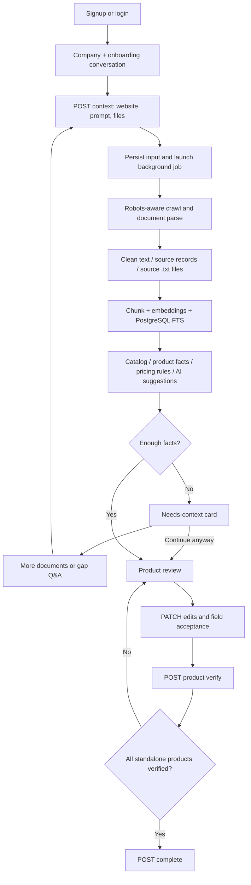

# Coirei Onboarding MVP — Low-Level Design

## State flow

## Database relationships

`users (1) -> (N) companies` (company **is** the workspace, no duplicated workspace binding table).

`companies (1) -> (N) products`; `products.parent_id` supports suites, modules and children. `products (1) -> (N) pricing_items` stores plan currency/units/periods separately. Plans are never products.

`companies (1) -> (N) sources`; each source has a version-specific hash and text, structured JSON-LD/metadata, robots status and crawl timestamp. `sources (1) -> (N) chunks`; chunk includes company ID, product ID when attributable, `vector(384)` and computed PostgreSQL `tsvector`.

`field_claims` preserves competing sourced facts and source IDs. `field_meta` JSONB describes status, review, confidence and quote per company/product field. `field_audits` records user edits and acceptance; re-extraction never overrides reviewed field values.

`companies (1) -> (1) conversations (onboarding)`; `conversations (1) -> (N) messages`, including actionable cards. `companies (1) -> (N) extraction_jobs`, `gap_questions` and user-owned `gap_answers`.

Phase-2 budget/campaign schema: `products -> projects -> campaigns -> campaign_budgets/campaign_results`. No creation or mutation endpoints for these tables in this MVP.

## Source quality rules

- First-party JSON-LD/metadata is extracted deterministically; it is not a guarantee of factual truth. Changes from conflicting first-party sources are preserved in `field_claims` and marked `conflict` where applicable.
- Catalog uses short titles/headings/nav/first-party product-section snippets. Fallback recovers named product sections conservatively. LLM-returned catalog products must be findable in stored first-party source text.
- Product extraction uses only selected source IDs. Every factual quote must match the specific source URL text before a field is accepted as `found_on_site`.
- Pricing is read from attributed product pricing pages. Shared `/pricing` can be assigned only when the catalog has exactly one sellable product. Numeric prices remain `pending` review and are not silently used for revenue forecasts.
- Derived market segment, value proposition and ICP are suggestions (65 confidence) until manually accepted. AI guesses do not become verified facts.
- Gap generation uses retrieved relevant snippets and checks every proposed answer against a stored snippet. **No arbitrary fallback to unrelated documentation.** It can return fewer than three suggestions.
- `candidate_kind='suite'` or `module` does not pass the standalone verification gate unless a human explicitly reclassifies it. Product `name` already existing must never become a false missing `products.0.name` question.

## Retrieval details

1. Text paragraphs are chunked around 1000 characters with limited overlap.
2. FastEmbed encodes batches (384 dimensions), with first download and CPU execution on your Mac.
3. Postgres query 1: `plainto_tsquery`/`ts_rank_cd` top 20 within company and page type.
4. pgvector query 2: cosine distance top 20 under a conservative relevance threshold.
5. Merge with reciprocal rank fusion `1/(60+rank)` and return up to 7 passages.
6. If embedding unavailable, index text with `NULL embedding` and use only full-text. An empty result is empty; do not invent supporting context.

## Consistency

- Company and product use independent numeric revisions. UI GET -> PATCH/verify with current product revision; stale edits return HTTP 409.
- `POST /companies/{id}/products` is find-or-create by owned company + product name.
- Repeated POST `/products/{id}/verify` after success returns `changed:false` when the revision is the post-verification revision or immediately preceding revision, without adding duplicate verification audit records.
- A user must approve required fields before verifying the product. Business-model/ICP pricing suggestions remain visible as pending optional fields unless the UI requires additional review.
- Background tasks are in-process and **not restart-safe**. Deployment needs a durable job queue; this initial build prioritizes small code and speed.

## Security limitations to address next

- All DB lookups are scoped by authenticated user, but rate limiting and per-account quotas are not implemented.
- The crawler checks public DNS addresses and same-site hostnames, but requires a production egress firewall against DNS rebinding and network-level SSRF.
- The HTTP fetcher obeys robots; no proxy/CAPTCHA bypass is provided. Avoid automated legal/terms/login extraction.
- No attachment virus scanning, OCR, JS rendering, refresh token rotation, email verification, or password-reset flow.
- Provide a strong JWT secret, HTTPS and a protected DB URL before any public exposure.
